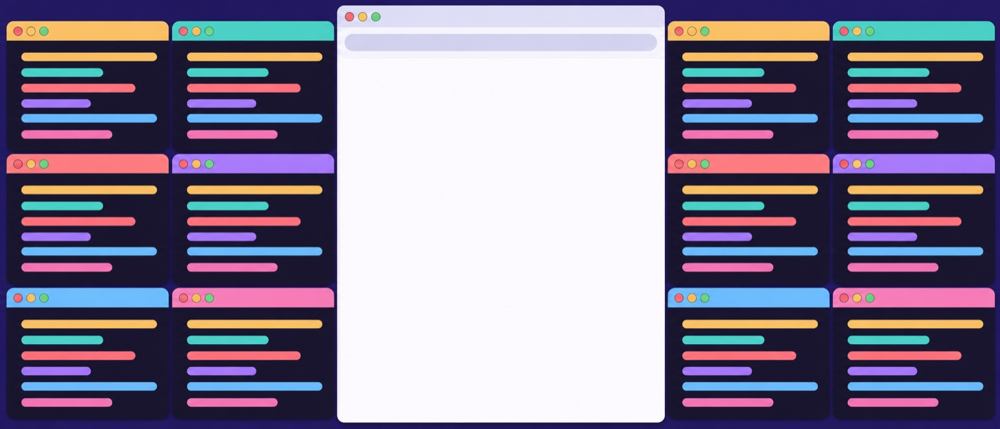

<div align="center">


# termquilt

### Ask Claude or Codex to tidy your terminals.

Too many coding agents open? termquilt puts every terminal window into a clean grid, using all the free space and leaving your other apps alone. Where the app allows it, the text ends up one readable size everywhere.

[](#requirements)
[](#which-terminals-work)
[](#then-just-ask)
[](#in-codex)
[](LICENSE)
[](https://github.com/eduardragea/termquilt/actions/workflows/ci.yml)

<br>

<table>
<tr>
<th>Before</th>
<th>After</th>
</tr>
<tr>
<td></td>
<td></td>
</tr>
</table>

<sub>Illustrations, not screenshots.</sub>

</div>

## Install

Paste this into Claude Code or Codex:

```text
Install termquilt by running:
curl -fsSL https://raw.githubusercontent.com/eduardragea/termquilt/main/install.sh | bash
```

That's it. You don't need Xcode, and it only takes a few seconds. It adds a small program to `~/.local/bin` and a skill to `~/.claude/skills` and `~/.agents/skills`, which is where Claude Code and Codex look. [The script](install.sh) is short if you'd like to read it first.

Not using either? Run the `curl` part in any terminal, then use the [hotkeys](#hotkeys) or [commands](#commands).

## Then just ask

In any Claude Code or Codex session, in any of your terminals, say what you want:

<p align="center">

</p>

```text
> tidy my terminals
12 terminals in a grid at 13 pt. Safari and Music stay clear; Discord got covered.

> raise the font
Done, 14 pt on all 12 terminals.

> a bit more
15 pt now, and Safari is still clear.

> actually, fill the whole screen
All 12 now fill the screen at 16 pt.

> put them back
Back where they were.
```

| Say something like | What happens |
|---|---|
| "tidy my terminals" | Every terminal snaps into a grid around your open apps |
| "raise the font", "smaller", "make it 16" | The text changes everywhere and the grid refits |
| "fill the screen" | Terminals take the whole screen, over other apps, until you say otherwise |
| "don't cover my apps" | Terminals go back to fitting around your apps |
| "put them on my laptop" | Everything moves to that screen, and stays there whenever these screens are connected |
| "use both screens" | Terminals are shared across all your screens again |
| "only the claude ones" | Only windows with that in their title get arranged |
| "put them back" | Undo. Say it again to redo |

The first time, Claude Code asks before it runs the installer and may ask once before using the skill, and macOS asks once per app to let termquilt control your terminal. If you never want it to ask about termquilt again, tell it "stop asking me for permission".

### In Codex

Codex runs commands in a sandbox that blocks controlling other apps, so termquilt has to run outside it. Codex asks you to approve that each time, until you say "stop asking me for permission" or add this line to `~/.codex/rules/default.rules` yourself:

```text
prefix_rule(pattern=["termquilt"], decision="allow")
```

Restart Codex after adding it. The rule matches the plain `termquilt` command, so `~/.local/bin` needs to be on your PATH.

## What you get

- **One font everywhere.** It picks the largest size where every terminal still shows at least 80×20 characters, or uses the size you ask for. [Some apps](#which-terminals-work) don't allow this, and it tells you when that happens.
- **All your terminal apps together.** Windows from different apps go into the same grid.
- **No overlaps and no wasted space.** Terminals fill all the room they're given, edge to edge.
- **Your other apps stay visible.** A browser in the middle of an ultrawide keeps its spot, with terminals on both sides. If something has to be covered, it tells you what.
- **Every screen gets used.** With a monitor plugged in, terminals are shared between it and the laptop, unless you ask for just one.
- **It remembers each screen.** Your laptop, your ultrawide and the monitor at work each keep their own text size and layout.
- **It stays out of the way.** Your agents keep running while their windows move. Your Terminal profiles don't change, and it never touches the network after installing.

## Hotkeys

When every agent is busy, there's nobody free to ask. Say "turn on the hotkeys", or run `termquilt hotkeys install`, and these work from anywhere:

| Hotkey | Does |
|---|---|
| <kbd>⌃</kbd> <kbd>⌥</kbd> <kbd>⌘</kbd> <kbd>T</kbd> | Arrange all terminals |
| <kbd>⌃</kbd> <kbd>⌥</kbd> <kbd>⌘</kbd> <kbd>=</kbd> | Bigger text everywhere |
| <kbd>⌃</kbd> <kbd>⌥</kbd> <kbd>⌘</kbd> <kbd>-</kbd> | Smaller text everywhere |
| <kbd>⌃</kbd> <kbd>⌥</kbd> <kbd>⌘</kbd> <kbd>F</kbd> | Switch between going around other apps and full screen |
| <kbd>⌃</kbd> <kbd>⌥</kbd> <kbd>⌘</kbd> <kbd>Z</kbd> | Undo |

They start with your Mac at login, and `termquilt hotkeys uninstall` turns them off.

## Which terminals work

| Terminal | Arranges windows | Changes text size | Needs Accessibility permission | Tested on the real app |
|---|---|---|---|---|
| **Terminal.app** | Yes | Yes | No | Yes |
| **iTerm2** | Yes | No, use ⌘+ and ⌘- | No | Yes |
| **Ghostty** 1.3+ | Yes | Yes | Yes | Not yet |
| **Alacritty** | Yes | Yes | Yes | Not yet |
| **kitty** | Yes | No | Yes | Not yet |
| **WezTerm** | Yes | No | Yes | Not yet |
| **Warp** | Yes | No | Yes | Not yet |

**"Not yet" means what it says.** That support was written from each app's documentation and hasn't been run against the app itself, so expect rough edges and please [report what you find](https://github.com/eduardragea/termquilt/issues).

Those apps have no way for another program to move their windows except through macOS Accessibility, so you'll need to turn that on for the app you run termquilt from, under System Settings > Privacy & Security > Accessibility. Until you do, termquilt leaves their windows alone and says why. iTerm2 only allows text size changes through its optional Python API, which termquilt doesn't use.

Terminals inside VS Code and Cursor aren't separate windows, so they aren't arranged.

## Requirements

- macOS 13 or newer, on Apple silicon or Intel
- One of the [terminals above](#which-terminals-work)
- Claude Code or Codex, if you want to ask in plain words. The hotkeys and commands work without them

## How it decides

<details>
<summary><b>Which apps keep their space</b></summary>

<br>

Terminals fill the free space around every other open app, even one they're currently covering. When there isn't room for everything, this is the order of priority, frontmost first within each group:

1. An app you can see right now keeps its space even if terminals have to get cramped, down to 60×15.
2. An app your terminals are covering keeps its space as long as every terminal stays at 80×20 or larger.
3. An app hidden behind other apps keeps its space only if that costs no text size.

Small windows (under 5% of the screen) don't count. Neither do hidden (⌘H) or minimized ones, so hiding an app is how you say it doesn't matter. Want a covered app back? Click it and tidy again.

</details>

<details>
<summary><b>Text size</b></summary>

<br>

Left to itself, it uses the largest size up to 18 pt at which every terminal still shows at least 80×20 characters. With too many windows for that, the text stays at 11 pt or larger and the terminals get smaller instead, because tiny text is worse than a narrow terminal. It tells you when that happens.

A size you pick is remembered per screen. It changes the text, not which apps the terminals go around. Terminals may drop below 80×20 to make that work, down to 60×15, and it says when they do. Past that, the app gets covered and it says that too.

</details>

<details>
<summary><b>Which screen, and where each window goes</b></summary>

<br>

With more than one screen, terminals are shared out by screen size, so each one gets about the same room. A window stays on the screen it's on while that screen has space for it. When some have to move, the ones nearest the other screen go. Each screen then gets its own grid, text size and layout, and the terminals go around other apps there as usual. Apps don't change how many terminals a screen gets, so an app you can see on the laptop doesn't push everything onto the monitor. If there's no room around it, it gets covered and you're told.

Ask for one screen ("put them on the big monitor") and they all go there. That's remembered for that set of screens, so your desk at home and your desk at work can differ. "use both screens" shares them out again.

Each window goes to its nearest slot, so things stay roughly where you left them. Asking again on a tidy screen changes nothing.

Rows differ by at most one window, and shorter rows stretch to fill. With 7 windows you get 4 above 3, so the bottom three are wider. No space is wasted, at the cost of those windows not being exactly the same width.

Moving a window doesn't raise it. If another app ends up covering a terminal, Terminal comes to the front, which takes focus. If nothing is covered, focus stays where it is.

</details>

<details>
<summary><b>Good to know</b></summary>

<br>

- In Terminal.app, fonts are set per window, so a new window starts with your profile's font until you tidy again.
- In Ghostty and Alacritty, a text size change applies to every window of that app at once. It's skipped when only some of them are being arranged, and undo can't bring back the old size.
- All tabs in a window get the new font, and a window with several tabs gets one slot.
- Minimized windows are skipped. So are Terminal.app windows on another Space.
- Undo goes back one step, to before the last run that moved a window, including the font and layout from then. It stops working once a terminal app restarts or opens, because window IDs can be reused.
- Which apps win depends on what's in front right now, so clicking a different app and tidying again can give a different layout.
- Terminal.app doesn't report Cmd-plus zoom, so termquilt works out a zoomed window's real font from its cell size.
- The download isn't notarized by Apple. macOS doesn't block it, because it's fetched with `curl` rather than a browser. You can always [build it yourself](#build-from-source).
- Settings live in `~/.config/termquilt`, and the hotkey log is at `~/Library/Logs/termquilt.log`.

</details>

## Commands

Everything the skill does, you can do yourself:

```sh
termquilt                  # arrange every terminal window
termquilt --dry-run        # see what it would do, without doing it
termquilt undo             # put everything back; run it again to redo
termquilt bigger           # one point bigger everywhere; `smaller` does the opposite
termquilt status           # your screens, saved settings, terminals, and which apps stay clear
```

| Option | Meaning |
|---|---|
| `--around` | Go around other apps when there's room (the default). Remembered for this screen |
| `--full` | Use the whole screen, even over other apps. Remembered for this screen |
| `--font 14` | Use this size, and remember it for this screen |
| `--font auto` | Go back to fitting automatically |
| `--display laptop` | Put everything on one screen: `laptop`, `external`, a number from `termquilt status`, or part of its name. Remembered for this set of screens |
| `--display all` | Share terminals across every screen again (the default) |
| `--match claude` | Only arrange windows whose title contains this text. Other terminals stay put and may end up covered |
| `--dry-run` | Change nothing and remember nothing, just report |

## Uninstall

```sh
curl -fsSL https://raw.githubusercontent.com/eduardragea/termquilt/main/install.sh | bash -s -- --uninstall
```

This removes the program, the skills, the hotkeys and termquilt's own settings. If you told Claude Code or Codex to stop asking about termquilt, that rule stays in `~/.claude/settings.json` or `~/.codex/rules/default.rules` until you remove it.

## Build from source

You need Swift 6, which comes with Xcode 16 or newer.

```sh
git clone https://github.com/eduardragea/termquilt.git
cd termquilt
make install        # the program, in ~/.local/bin
make install-skill  # the skill, linked into ~/.claude/skills and ~/.agents/skills
```

## Contributing

Bug reports are very welcome, especially from anyone using a terminal marked "Not yet" above. You can propose code changes through a pull request, and the maintainer reviews and merges them. [CONTRIBUTING.md](CONTRIBUTING.md) shows how to build, test and find your way around.

## License

[MIT](LICENSE)
